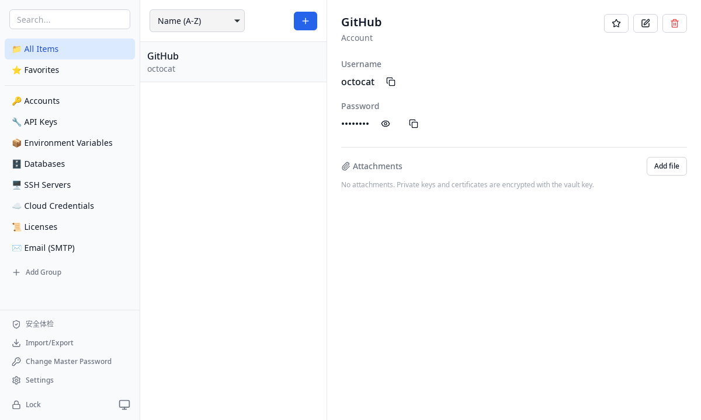
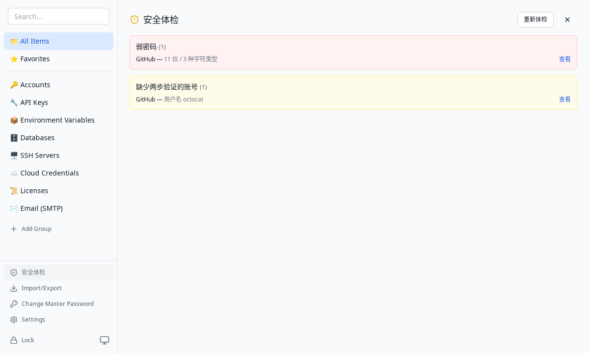

<p align="center">
  
</p>

<h1 align="center">SecKeyBox</h1>

<p align="center">
  面向开发者的本地优先密码管理器
</p>

<p align="center">
  <a href="https://github.com/EthanCheung-gh/SecKeyBox/releases"></a>
  
  <a href="license"></a>
</p>

<p align="center">
  <a href="README.md">English</a> · 简体中文
</p>

---

## 为什么选择 SecKeyBox

开发者的凭证并不符合经典密码管理器"网站 + 密码"的模型。SecKeyBox 内置八类专用条目——从数据库连接、SSH 服务器，到云凭证、许可证和 SMTP 账号——全部保存在本地加密的 SQLite 数据库里，与任何服务器零交互。

**安装包不包含任何内置凭证。** 首次启动会引导你创建保险库并自设主密码。无账号、无云端、无遥测。

## 截图

| 保险库主界面 | 安全体检 |
|--------------|----------|
|  |  |

## 功能

| 领域 | 说明 |
|------|------|
| 8 类凭证条目 | 账号、API Key、环境变量、数据库连接、SSH 服务器、云凭证、许可证、SMTP 账号 |
| 专用字段 | 例如数据库：类型/主机/端口/库名/用户/密码/连接串；SSH：主机/端口/用户/密码/私钥路径/私钥口令 |
| 加密 | 每字段独立 AES-256-GCM 加密 + 随机 nonce；密钥由主密码经 Argon2id 派生（m=64MB，t=3，p=4） |
| 主密码修改 | 校验当前密码、派生新密钥，并在单个事务内重加密**全部**密文——失败即回滚，库仍可用旧密码打开 |
| 分组管理 | 每类凭证一个内置分组；所有分组（含内置）均可重命名、删除——删除分组时先把组内条目移入回收站，再删除该分组 |
| 搜索 | 侧边栏搜索框实时过滤条目标题与副标题（后端 SQL LIKE）；`Ctrl+Shift+Space` 呼出系统级快速搜索条——↑↓ 选择、回车复制密钥 |
| 两步验证（TOTP） | 每个账号可存 base32 密钥，详情面板显示实时 6 位验证码与倒计时环 |
| 密码生成器 | 加密级随机、字符集保底、长度/字符集/排除易混字符可选，内嵌于所有密码输入框 |
| 密钥历史 | 轮换密码 / 密钥前的旧值以密文归档，详情面板可查看、可复制 |
| 安全体检 | 本地审计：弱密码、重复密钥、长期未轮换、缺少 2FA 的账号、临期许可证 |
| 导入 / 导出 | JSON 备份导出；导入支持合并 / 替换。另支持从 Chrome / Bitwarden / 1Password / LastPass CSV 批量导入（folder 列自动建组、TOTP 列一并导入）及 `.env` 文件导入 |
| 命令行取密 | `seckeybox-cli` 通过本地 socket（权限 0600）从运行中的应用读取密钥：`export DB_PASSWORD=$(seckeybox-cli get "生产数据库")`。只读——永远无法解锁或修改保险库 |
| 加密附件 | 任意条目可挂载 SSH 私钥、证书、`.env` 或图片（≤5 MB）；内容经 AES-256-GCM 加密，仅文件元数据可读 |
| TOTP 导入 | 粘贴 `otpauth://` URI 或扫描二维码截图，自动填充密钥、签发方与账号（支持 6 位 / 30 秒标准条目） |
| 自定义字段 | 任意条目可添加加密的键值对，记录模板之外的信息 |
| 标签 | 跨分组的标签，侧边栏可按标签筛选，一个条目可带多个标签 |
| 本地备份 | 基于 `VACUUM INTO` 的一致性快照：每天一份 + 手动备份，保留最近 10 份；恢复前校验完整性并先快照当前状态 |
| 回收站与恢复 | 删除条目时不会直接抹除，而是移入隐藏的回收站分组：可还原到原分组（原分组不存在时回落到其他分组）、单独彻底删除，或清空回收站。保留期可配置（默认 30 天），过期条目在每日备份完成后自动清理 |
| 完整性自检 | 逐个解密所有密文字段——8 类条目、自定义字段、密钥历史，可选附件——并执行 SQLite 完整性检查与外键检查；失败按条目 / 字段报告，不泄露任何明文或密文 |
| 重复项整理 | 按类型与身份字段（账号的用户名 + 网站主机、SSH 的 user@host:port、API Key 的名称 + 端点等）归并活跃条目；保留你选定的副本，并把标签、附件、自定义字段、密钥历史迁移过来，其余移入回收站 |
| 托盘常驻 | 关闭窗口后应用驻留系统托盘（显示 / 锁定 / 退出），全局快捷键与空闲锁定继续生效 |
| 会话安全 | 自动锁定可配置（关闭 / 1 / 5 / 15 / 30 分钟，由应用进程强制执行，窗口隐藏也生效）；剪贴板自动清除可配置（0 / 15 / 30 / 60 秒）；密钥释放时内存清零 |
| 外观 | 亮色 / 暗色 / 跟随系统主题 |

备注字段按设计以明文存储；所有密码 / 密钥 / 秘密字段均为密文。

## 命令行

Linux `.deb` 会把 `/usr/bin/seckeybox-cli` 与主程序一起安装。CLI 自身不做任何解密：它通过本地 socket（权限 0600）与运行中的应用通信，仅在保险库已解锁时可用。

```bash
seckeybox-cli status                        # locked | unlocked
seckeybox-cli list [查询词]                  # id <TAB> 类型 <TAB> 标题
seckeybox-cli get "GitHub"                  # 输出主密钥字段
seckeybox-cli get "GitHub" --field username
seckeybox-cli get --id <id> --json
seckeybox-cli totp "GitHub"                 # 当前 6 位验证码

export DB_PASSWORD=$(seckeybox-cli get "生产数据库")
```

退出码：`0` 成功，`1` 保险库已锁定，`2` 未找到 / 标题歧义 / 参数错误，`3` 无法连接应用。

## 安全模型

```
主密码
   │  Argon2id (m=64MB, t=3, p=4)
   ▼
32 字节密钥 ──► AES-256-GCM，每字段独立随机 nonce
   │
   ▼
本地 SQLite 数据库中的敏感字段
```

- 主密码永不离开本机；数据库中仅保存其 PHC 哈希与盐（用于校验）。
- 锁定即销毁内存密钥；解锁需重新派生。
- 修改主密码会在事务内原子轮换全部数据密钥（轮换、空密文、回滚均有[单元测试](src-tauri/src/db/operations.rs)覆盖）。

## 下载

前往[最新 Release](https://github.com/EthanCheung-gh/SecKeyBox/releases/latest) 获取安装包：

| 平台 | 产物 |
|------|------|
| Windows | `.msi` 或 `.exe`（NSIS 安装器） |
| macOS（Apple Silicon） | `.dmg` |
| Linux | `.deb`（内含 `seckeybox-cli`）、`.rpm`、`.AppImage` |

## 从源码构建

前置要求：[Rust](https://rustup.rs) 1.70+、Node.js 18+，以及你所在平台的 [Tauri v2 系统依赖](https://tauri.app/start/prerequisites/)（Debian/Ubuntu 为 `libwebkit2gtk-4.1-dev libgtk-3-dev` 等）。

```bash
git clone https://github.com/EthanCheung-gh/SecKeyBox.git
cd SecKeyBox
npm install

npm run tauri dev     # 以开发模式运行桌面应用
npm run tauri build   # 在 src-tauri/target/release/bundle/ 产出安装包
                      # （会先编译 CLI；deb 包内含 /usr/bin/seckeybox-cli）
```

常用脚本：

```bash
npm run dev           # 仅前端，跑在普通浏览器里（内置 mock 替代 Tauri
                      # 后端，附带演示数据，便于纯界面调试）
npm run build         # 类型检查 + 生产构建
npm run build:cli     # 编译 seckeybox-cli（cli/target/release/seckeybox-cli）
npm test              # 前端单元测试（Vitest）
cd src-tauri && cargo test   # 单元测试，含重加密、回收站、完整性自检与重复项
```

`.github/workflows/ci.yml` 在每次 push 与 PR 时执行 `tsc`、前端测试、前端构建与 `cargo test`。

## 项目结构

```
SecKeyBox/
├── src/                    # React 前端
│   ├── components/         # 布局、弹窗、解锁界面、基础组件、安全与回收站面板
│   ├── stores/             # Zustand 状态（vault / ui / settings）
│   ├── lib/                # Tauri API 封装、工具函数
│   └── mocks/              # 仅开发用的 Tauri 后端浏览器 mock
├── src-tauri/              # Rust 后端
│   └── src/
│       ├── commands/       # Tauri 命令（vault / items / 附件 / 导入导出）
│       ├── crypto/         # Argon2id KDF + AES-256-GCM + TOTP
│       ├── db/             # 建表、迁移、数据访问，回收站 / 完整性 / 重复项
│       ├── ipc/            # 供 CLI 使用的本地 socket 协议
│       └── state.rs        # 内存保险库状态（主密钥、空闲计时）
├── cli/                    # 独立编译的 `seckeybox-cli` crate
└── .github/workflows/      # ci.yml（push/PR 检查）+ release.yml（tag 触发的三平台发布）
```

## 开发计划

- [ ] 浏览器扩展
- [ ] 移动端应用
- [ ] 端到端加密云同步
- [ ] 恢复密钥 / 应急包
- [ ] 自动填充

## 贡献

欢迎 Issue 与 Pull Request。较大的改动请先开 Issue 讨论设计。

## 许可证

[Apache License 2.0](license) © 2026 EthanCheung
